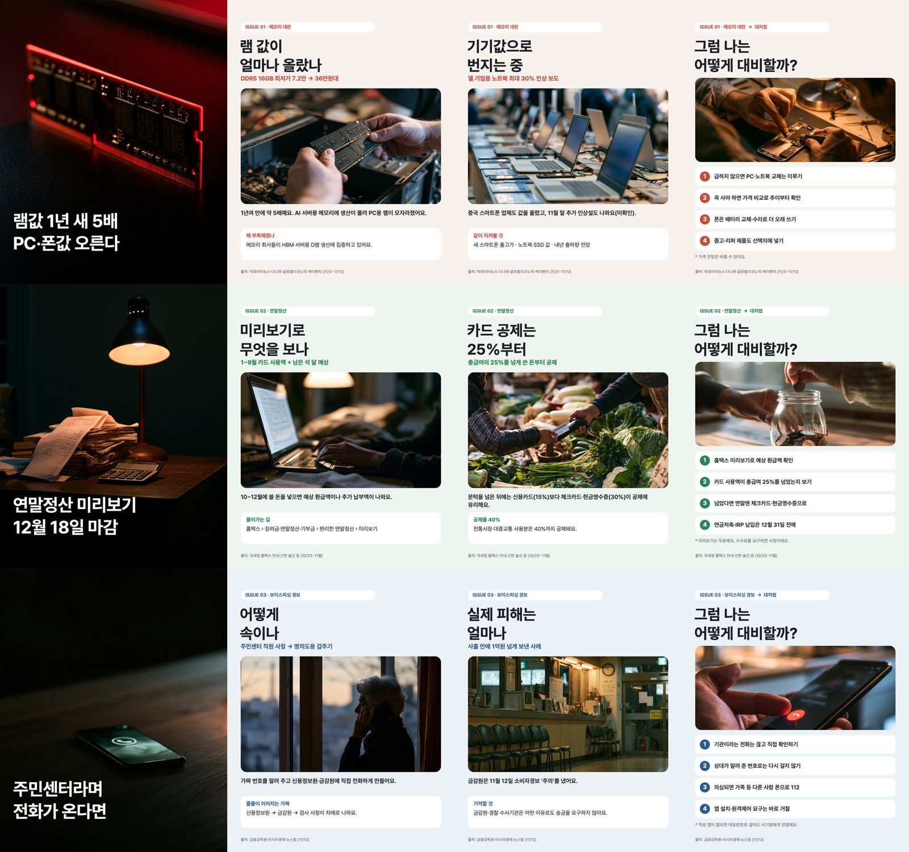

# daily-economy-cardnews

그날 한국 개인에게 영향이 큰 경제·금융 이슈 3개를 골라 **실사 사진 카드뉴스 12장**(이슈당 4장, 마지막 장은 대처법)을 만들고, 승인을 받은 뒤 **SNS 6곳에 이슈별로 게시**하는 [Claude Code](https://claude.com/claude-code) 스킬입니다.



## 하는 일

1. WebSearch 로 오늘의 경제 이슈 3개를 고릅니다(숫자는 출처 두 곳 이상으로 확인).
2. 카드 문구를 `content.json` 으로 씁니다.
3. Midjourney 로 실사 사진 12장을 만듭니다. 일러스트·캐릭터는 쓰지 않습니다.
4. 카드를 렌더링합니다. 표지는 사진을 화면 가득 깔고 흰 굵은 두 줄 제목을 얹습니다.
   - 4:5 (1080×1350): Threads·X 사진 게시물, Figma 기록용
   - 9:16 (1080×1920): 릴스·Shorts·TikTok 영상용. 플랫폼 버튼이 가리는 아래·오른쪽엔 글을 두지 않습니다.
5. 이슈별 16초 영상과 플랫폼별 게시글(글자 수 제한 확인)을 만듭니다.
6. **사용자에게 미리보기를 보여 주고 승인을 받습니다.** 승인 없이는 게시하지 않습니다.
7. Facebook·Instagram 릴스, Threads, X, TikTok, YouTube Shorts 에 이슈별 게시물을 올리고 URL 을 확인합니다.
8. (선택) Figma 월별 페이지에 레이어를 나눈 편집 가능한 사본을 남깁니다.

카드만 만들고 게시는 직접 하고 싶다면 "게시 없이 카드만" 이라고 하면 1~5단계만 합니다.

## 설치

Claude Code 에서:

```
/plugin marketplace add yongsuahn/daily-economy-cardnews
/plugin install daily-economy-cardnews@yongsuahn-skills
```

또는 `skills/daily-economy-cardnews` 폴더를 `~/.claude/skills/` 에 복사해도 됩니다.

## 필요한 것

- **macOS**: 카드 렌더러가 Swift + AppKit 입니다(`swift` 는 Xcode Command Line Tools 에 포함).
- **ffmpeg**: 영상·미리보기 생성.
- **Midjourney 유료 계정**: 사진 생성. 브라우저에 로그인돼 있어야 합니다.
- **브라우저 자동화**: 게시 절차는 [Aside](https://aside.so) 브라우저의 REPL(Playwright 식 API) 기준으로 적혀 있습니다. 다른 도구를 쓰면 `references/publishing.md` 의 선택자·순서를 참고해 옮겨야 합니다.
- **(선택) Figma MCP**: 8단계 기록용.

## 설정

처음 실행하면 `~/.config/daily-economy-cardnews/config.json` 이 없을 때 [`config.example.json`](skills/daily-economy-cardnews/config.example.json) 을 복사해 두고 값을 채워 달라고 합니다. 채우기 전엔 카드 만들기까지만 합니다.

| 키 | 뜻 |
| --- | --- |
| `workdir_root` | 날짜별 작업 폴더를 만들 곳 |
| `brand` | 내 앱·서비스 이름. 카드에서 홍보하지 않도록 쓰입니다 |
| `platforms` | 게시할 곳. 빼면 건너뜁니다 |
| `accounts` | 페이지 이름·핸들·YouTube 채널 ID |
| `meta` | Meta Business Suite 주소의 `asset_id`·`business_id` |
| `figma` | 기록할 파일 키 등. 비우면 Figma 단계를 건너뜁니다 |
| `notes` | 추가 지시(자유 문장 목록) |

설정 파일은 저장소 밖에 있어서 플러그인을 업데이트해도 지워지지 않습니다.

## 원칙

- 실사 사진만, 보도사진은 쓰지 않음(저작권). 게시글에 "AI 로 만든 연출 사진" 이라고 밝힙니다.
- 확인 안 된 의혹은 "의혹·보도" 로 표시하고, 투자 관련 이슈엔 "투자 권유 아님" 을 붙입니다.
- 자기 브랜드 홍보와 엮지 않고, 개인이 할 수 있는 대처법을 줍니다.

## 라이선스

MIT. 포함된 Pretendard 글꼴은 [SIL Open Font License 1.1](skills/daily-economy-cardnews/assets/fonts/LICENSE-Pretendard.txt) 입니다.
